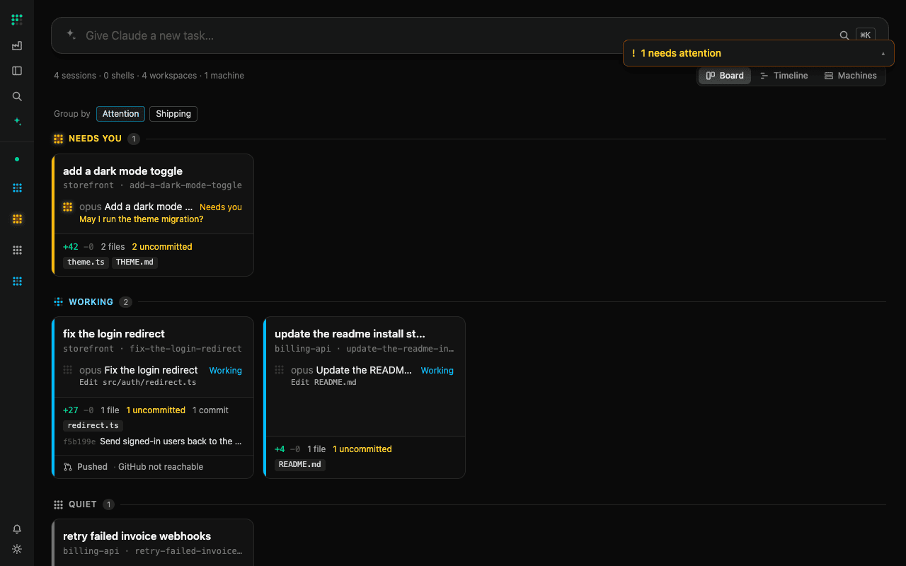
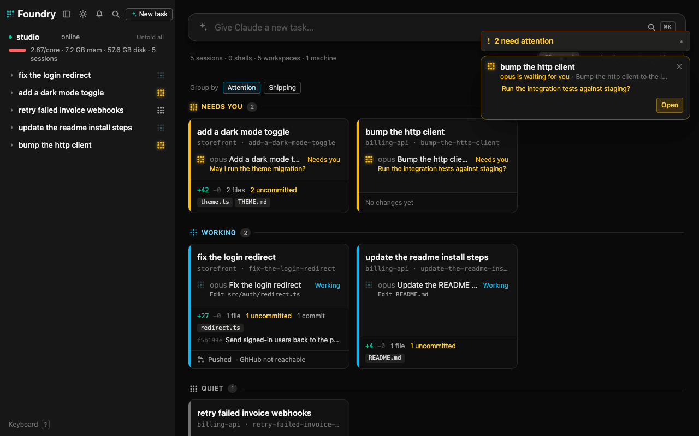
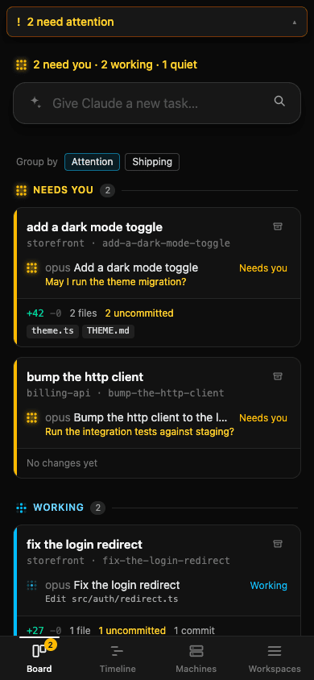

# The board and the sidebar

The board is the home of Foundry once any workspace exists. It shows every workspace as a card, with what each session is doing and what the workspace has changed. The sidebar beside it lists the same workspaces and terminals, and stays with you when you open a terminal.

To get back to the board from anywhere, click **Foundry** at the top of the sidebar, or the mark at the top of the rail.

## Project faces

Every project has a face: two letters from its name on a small coloured tile, such as **ST** for storefront and **BA** for billing-api. Its workspaces carry it wherever they show: on a board card and a list line, in the sidebar, and beside the workspace name in a terminal's bar. The task box shows it on each project button. So in a long list you can tell which project a workspace belongs to without reading it. Point at a face to see the project's name.

The colours keep clear of the state colours, so a face never reads as a state. Each project keeps its colour when another is added, and every machine shows the same one. With more than six projects, colours repeat, and the letters tell them apart.

## Reading a card

Each workspace is one card. The coloured bar on its left edge takes the colour of its most urgent terminal.

- **Title.** The workspace name. Click it to open its most urgent terminal. Below it, the project and the branch, led by the project's face. A workspace that sits on a commit, with no branch, shows the first 7 characters of that commit instead, such as `demo · fedcba9`.
- **Factory mark.** A workspace the factory builds in has a violet **factory #N** after its name, where N is the issue it builds. Click it to open the issue on GitHub. Its line in the board's list has the same mark. In the sidebar the mark is short, **#N**, since the workspace's name already says it is a factory task.
- **Machine name.** Shown at the right of the title when the fleet has more than one machine.
- **Terminals.** One row per session or shell, most urgent first. A row has its state glyph, its name, and its state label. For a session on this machine, the row also has the title it took from its first prompt, and underneath what it is doing right now, such as "Edit src/auth/redirect.ts" or the question it asked you. Click a row to open that terminal. A card shows four rows, then "+N more". A workspace with none says "No terminals".
- **What Claude said.** When a session on this machine is **Ready** or **Ended**, what Claude said at the end of its last turn shows under its row, three lines at a time. Click it to read it all.
- **Reply.** For a **Ready** session, reading it all also opens a reply box. Type and press `Enter` to answer without leaving the board. The reply goes into the session's terminal as if you typed it there. Since what Claude said shows only for sessions on this machine, so does the box.
- **Next step.** The first **Ready** session of a workspace on this machine also gets buttons under its row, such as **Commit 1 file**, **Push 1 commit**, **Open a PR**, **Fix failing checks** or **Address the review**. Press one and Foundry types that instruction to Claude for you. [Next steps for an idle session](sessions.md#next-steps-for-an-idle-session) lists them all.
- **Archive.** The small box button at the top right of a card. With a mouse it shows when you point at the card. See [End, clear and archive](sessions.md#end-clear-and-archive).

### The changes line

The footer of each card of a workspace on this machine says what the workspace changed since it left its base branch. It shows lines added and removed, the number of files, how many are uncommitted and how many commits, then the three files with the most changed lines and the newest commit. A card with nothing says "No changes yet". Click the footer to open the full changes sheet for the workspace.

The line reads the changes only while the card is on screen. It reads them when the card comes on screen, whenever one of the workspace's terminals changes state, and every 30 seconds while an agent in it is working. So the end of a turn shows what the turn wrote. Only the machine that holds a workspace can read its changes, so a card for another machine's workspace has no changes line; while that workspace is being archived, its card says "Archiving…" there instead. A failed read says "Its changes can't be read from here". When the daemon answers that it does not have the workspace, its changes are not read again when its terminals change state, nor every 30 seconds.

### Where the work has got to

On cards of this machine, a line under the changes says how far the branch has travelled. It reads, for example, **Not pushed** with "1 commit only here", **Pushed** with "No PR yet", or the pull request number with its checks and review, such as "Checks pass" and "Approved". The pull request number links to GitHub. When the pull request is merged and no commit came after it, the line offers **Archive**.

## Group the board

**Group by** above the cards switches between two ways to sort them. The choice is kept in this browser.

**Attention** is the default. It sorts by what each workspace needs, and leaves out empty groups.

- **Needs you.** A session asked something, is stuck or failed.
- **Working.** An agent is working or starting.
- **Quiet.** Nothing is happening.

A factory run's card follows its run, not its sessions. While the run is live, the factory tends its sessions, so the card stays under **Working** even when one of them waits or fails, and a session with ten minutes of no output reads **Quiet 10+ min** instead of **Stuck**. The card moves to **Needs you** only when the run itself is stuck or needs answers on its issue, even if none of its sessions waits, and the tab's count and the amber strip count it then too. Then a stuck session in it reads **Stuck** again, and its ended terminals, its **Ready** sessions and its open shells read **Stuck** or **Needs info** with the reason the factory gave, cut to fit; hover the label to see all of it. In a live run an ended terminal reads the run's step instead, such as **Building** or **PR open**. See [Session states](sessions.md#session-states).

Inside a group, the most urgent card comes first. The amber strip at the top of the page opens the first session that needs you, and from there leads to the rest. See [Go through what needs you](sessions.md#go-through-what-needs-you).

**Shipping** sorts by how far each workspace's work has gone on its way to the main branch.

- **Only here.** Edits or commits GitHub does not have yet.
- **Pushed.** The branch is on GitHub with no open pull request.
- **In review.** A pull request is open.
- **Merged.** Its pull request merged.
- **No changes yet.** No edits or commits since the workspace left its base branch.
- **Not read from here.** Another machine's workspace, or one whose changes could not be read.

Beside the buttons, a line counts each stage and sums the work, for example "3 only here › 1 pushed › 0 in review › 0 merged · +136 −0 · 2 commits". While Foundry is still reading the workspaces it says "Reading where each workspace's work stands…".

## Cards or a list

**Cards** and **List**, at the right of **Group by**, switch how each workspace is drawn. The choice is kept in this browser.

A card shows everything above. The list puts each workspace on one line, so a fleet of dozens fits on a screen, in the same groups and order:

- **Glyphs.** One per terminal, in the same order as a card's rows. Click one to open that terminal, or right-click it for its menu. With more than three terminals, the line shows two and "+N".
- **Name.** Click it to open the most urgent terminal. Below it, the project and the branch.
- **What it is doing.** The most urgent terminal's state, then the question it asks you, the tool it runs, or the first line of what Claude said last. Point at that line to read all of it.
- **Changes.** Lines added and removed and how many files are uncommitted, or "No changes". Click it to open the changes sheet. It is read the same way as a card's changes line, and a line for another machine's workspace says "Not read".

On a phone the line takes two rows: the name on the first, and what it is doing and its changes on the second.

To reply to Claude, use a next-step button or see the pull request line, switch back to **Cards**.

## Counts and views

Under the task line, a line counts what the fleet holds, such as "5 sessions · 0 shells · 5 workspaces · 1 machine". When a machine is offline, it adds "1 offline". The line is hidden on a narrow screen.

At its right, three buttons switch the view of the whole home.

- **Board.** The cards described above.
- **Timeline.** Every session's turns on one clock.
- **Machines.** One card per machine. See [Machines](machines.md).

This browser remembers whether you last chose **Board** or **Timeline**. **Machines** has an address of its own instead. The task line stays where it is while the view changes, so a task half written survives a switch.

## Timeline

The timeline answers "what has each agent been doing". Each session on this machine that took a turn in the window gets a row, and each turn is a bar from its prompt to its end. Sessions on other machines do not show.

- A bar that is still going runs up to the **now** edge, in its session's colour. A finished turn is paler.
- A tick on a bar is a tool Claude ran. An amber dot is a question it asked.
- From a question to the step after it, the bar has amber stripes: the turn was waiting on you, not working. While a session still waits, its stripes run to the **now** edge and its row says for how long, for example "Needs you for 12m".
- Point at a bar to see what the turn was and did, and how long it waited on you. Click it to open the terminal with its steps column.
- The line above the rows sums the window: turns, agent time, time waiting on you, tool calls and questions. Time waiting on you is not counted as agent time.
- **Waiting on you**, the first row, lays every session's waits on top of each other. It is taller where more sessions waited at once, so you can see when you held the fleet up. While any session waits, click its name to open the one that has waited longest. The row only shows when something waited on you in the window.
- **15m**, **1h**, **4h** and **12h** pick the window. The choice is kept in this browser.
- Sessions with no turn in the window are counted below, for example "1 more session took no turns in the last hour".

The timeline only has turns from after this machine's daemon started.

## The sidebar

The sidebar is the same fleet as a list. It sits at the left on a wide screen. From the top:

- **Foundry** goes to the board.
- The buttons in the header are, in order, the factory icon (opens the Factory view), **Collapse sidebar**, a theme switch, **Settings** (a gear), the bell for notifications, **Jump to** and **New task**. **Collapse sidebar** shows only on a wide screen. `Cmd+,` (`Ctrl+,` on Windows and Linux) opens Settings too, except in a text field or a terminal.
- Each machine has a status dot, its name, and its status. Click the name to open the machine's page in Settings, with its name, limits and waiting release. Under it, a load bar and one line of numbers, such as "2.88/core · 8.1 GB mem · 59.8 GB disk · 4 sessions". Point at the line for fuller numbers. The bar turns amber at 0.7 load per core and red at 1.
- Under the numbers, when there is something to sweep, the machine's sweep line. **Clear N ended** clears every terminal that ended in any of its workspaces, as each workspace's own **Clear N ended** does. **Archive N empty** archives every workspace with no terminals left, except one a factory run still holds, and, until the factory's status has arrived, any of a project whose factory is on. It does not ask first, and it never forces: a workspace with uncommitted or unpushed work is kept, and the line says how many were kept. The button reads **Archiving N…** while it runs, and each card being archived says so too. Branches stay. While the page shows the fleet this browser remembered, or the link to the daemon is lost, both buttons wait for the daemon's word.
- Under a machine, its workspaces. **Fold all** at the right of the machine line folds every workspace, and then reads **Unfold all**.
- **Keyboard** at the bottom lists every key the app answers. `?` opens it too.

### Folding

A folded workspace is one row: its project's face, its name and a strip of state glyphs, most urgent first. The strip shows six, then "+N". Click a glyph to open that terminal. Click the face or the name to unfold.

Under its name, a folded workspace shows its project, then where its work stands, such as "Draft PR #307 · Checks running", "Building", "Pushed · No PR yet" or "PR #9 merged", the pull request a link to it on GitHub. An unfolded workspace ends that line with its branch, or its commit when it has no branch, unless the branch is the workspace's own name, as a factory task's is. Under that line come its terminals, one line each: the state glyph, the name, then what the session is doing right now, such as "Edit src/auth/redirect.ts" or the question it asks you, or, with nothing in flight, its title (the name you gave it, or its first prompt), and last the state label. While the step shows, point at the row to read the title.

A thin bar hangs from each workspace's face to its bottom, folded or not, so you can see where one workspace ends and the next begins. It takes the colour of the workspace's most urgent terminal, the same colour as the bar on its board card.

The workspace you are in unfolds by itself and folds again when you leave. One you unfolded yourself stays open. Which are open is kept in this browser.

### A workspace's actions

Point at an unfolded workspace and a row of buttons shows on its name's line, after the name and before any factory mark. On a touch screen they are always shown.

- **Changes.** Opens the changes sheet.
- **New session.** Asks for a model and a first prompt, then starts Claude Code in this workspace.
- **New shell.** Opens a shell in this workspace. It shows in the list, where you can open it.
- **Clear N ended.** Only when some terminals have ended.
- **Archive.** Shows for a workspace on any machine.

[End, clear and archive](sessions.md#end-clear-and-archive) says what the last two do.

Right-click a terminal anywhere it is listed, or press and hold it on a touch screen, for its menu. That is in the sidebar, on a board card, in the rail's Sessions list, or in a tab. [The terminal's menu](sessions.md#the-terminals-menu) lists what it offers.

### Using the keyboard

The workspace list is one Tab stop. Once inside:

- `Up` and `Down` move between workspaces and terminals.
- `Right` unfolds a workspace or goes into it. `Left` folds it, or from a terminal goes up to its workspace.
- `Home` and `End` go to the first and last.
- Typing letters goes to the next entry whose name starts with them.
- `Enter` opens a terminal, or folds and unfolds a workspace.

## The rail

The rail is the sidebar squeezed to a strip as narrow as a button. It gives a terminal more room. It holds only buttons; **Sessions** lists every terminal when you want them.

Press the **Collapse sidebar** button in the sidebar header, or `Cmd+B` (`Ctrl+B` on Windows and Linux, outside a terminal). **Expand sidebar** on the rail, or the same key, brings the list back.

On the rail, from the top:

- The Foundry mark goes to the board, and the factory icon goes to the Factory view. See [The factory](factory.md).
- **Sessions**, with a badge counting the terminals that need you, when any do.
- **Jump to** and **New task**.
- At the bottom, **Expand sidebar**, the bell, the theme switch and **Settings**.

**Sessions** opens every session and shell of the fleet as one list, grouped **Needs you**, **Working**, **Ready**, **Ended** and **Unreachable**, with empty groups left out. **Needs you** holds exactly what the board's Needs you lane holds. Each row shows its state, its workspace, the factory issue when it is a factory run's, the terminal's name with what it is doing or its title, and its machine when there is more than one. A row is a link to its terminal, and right-clicking it opens the terminal's menu, whose **Rename** opens the terminal and edits the name in its tab. **Ended** has a **Clear N** button that clears the terminals in it.

The list floats over the terminal. Picking a session or opening one from a row's menu, `Esc`, or a click in the main pane closes it. **Dock beside the rail** keeps it open as a column instead, and picking a session leaves it open; **Undock** floats it again. Whether it is docked is kept in this browser.

Opened from its button, the list starts on the terminal you are in, or on its first row. It is one Tab stop, docked or not, and `Up`, `Down`, `Home` and `End` move through it.

The choice of rail or list is kept in this browser. With none kept, a window narrower than 1024 pixels starts on the rail.

## Jump to anything

The jump palette is how you reach any session or shell without going through the lists, and any view or action of the app. Press `Cmd+K` on a Mac, or `Ctrl+K` elsewhere. Inside a terminal the shell keeps `Ctrl+K` for itself, so use a **Jump to** button there: in the sidebar header, on the rail, or in the terminal's header on a phone. The search icon in the board's task line opens it too.

Type a few words. A row matches when it holds every word, in any of its workspace name, session or shell name, first prompt, state, project, branch or machine. So `storefront working` finds working sessions in that project.

- `Up` and `Down` move through the list and `Enter` opens the picked terminal.
- `Shift+Enter`, or `Shift` and a click, opens it beside the terminal you already have open, in a split. See [Two terminals side by side](sessions.md#two-terminals-side-by-side).
- `Tab` lists what you can do with the picked terminal, as its right-click menu does. Type to narrow that list and press `Enter` to do the picked one. `Esc`, `Shift+Tab` or `Backspace` in an empty box goes back.
- On a wide screen, a preview beside the list shows what the highlighted session was asked, its last turn, what Claude said and what its workspace changed. For a session on another machine it says which machine keeps them.
- With nothing typed, the views sit in a row over the list: **Board**, **Timeline**, **Machines**, **Factory** and **Settings**, the one you are on marked. Pick one to go there, from a terminal or a phone too.
- **Do** lists the app's actions, each with the key that does it from anywhere: **New task**, **Next that needs you** (with how many need you), **Collapse sidebar** or **Expand sidebar** on a wide screen, and **Keyboard shortcuts**. After them, **Settings: Factory**, **Settings: Notifications** and the like open each page of Settings. They come after the sessions and shells.
- After the actions come **New shell in** each workspace. Pick one to open a shell there.
- Once you type, the views and actions that match come first, so `mach` then `Enter` opens the machines view and `keys` the list of keys.
- The last row, **New task "your words"**, opens the New task dialog with what you typed. If nothing matches, the palette says "Nothing matches" and that `Enter` makes it a task for Claude.

`Esc` closes the palette.

## Notifications

You do not have to watch the board. Foundry tells you once when a session finishes its turn, and once when one needs you. A session needs you when it is waiting for you, stuck after ten minutes with no output, or failed. A session in a live factory run never needs you, since the factory tends it. It raises no toast or alert when it waits, is stuck or failed, the tab does not count it, and the **While you were away** card shows it as the board does. You are still told when it finishes its turn. If its run is then held up, a session in it that already waits, is stuck or failed needs you, and you are told then. You get no toast for a terminal that is on screen.

The bell in the sidebar header and at the foot of the rail opens **Settings → Notifications**, where you choose how the news reaches you. A change there takes effect at once.

- **Cards in the page.** On by default. While you are at Foundry, a toast slides in at the top right, with what Claude said or is doing.
- **Desktop alerts.** Off by default. When Foundry is in the background, you get a desktop alert instead of a toast. Turning it on asks your browser for permission. A click on the alert opens that session. Returning to the page clears the alerts. If your browser blocks them, the switch is disabled and says to allow notifications in the site settings. **Browser permission**, under the switch, says what your browser allows: allowed, blocked, not asked yet or not supported.
- **Catch-up when you come back.** On by default. After two minutes away, a card says what each session did meanwhile.

The three choices are kept in this browser. The bell is filled when desktop alerts are on, and crossed out when all three are off.

The tab always carries the news. Its title counts what needs you first, such as "(2) Foundry · 2 need you", then what works, "Foundry · 3 working", and is plain "Foundry" when all is calm. Its icon is the fleet's most urgent state, and ripples while an agent works. A screen reader hears each piece of news too.

### Toasts

A toast shows the workspace, the session and what happened, then what Claude said or what it is doing. **Open** goes to its terminal.

If the session is **Ready** and on this machine, the toast also has a reply box. Type and press `Enter`, and your reply goes into the session as if you typed it in its terminal, without leaving where you are.

A toast for a finished turn goes away after 12 seconds, unless the pointer or the keyboard is on it, or you started a reply. A toast for a session that needs you stays until the session moves on. The X button, or `Esc` with the toast focused, closes it. A toast also leaves once you open the terminal or the session moves on.

### The catch-up

Come back to the page after two minutes or more, in another tab or app, or after closing it, and a **While you were away** card heads the stack. It says how long you were away, then gives one line for each session that changed or needs you, most urgent first. A line shows the state, the turns and tool calls since, and the question or last words. A session that started while you were away is marked **New**. Click a line to open it. The X button, or `Esc`, closes the card. If nothing moved, nothing shows.

## When something needs you

A session that asks you something, is stuck or failed leads from the amber strip at the top of the page. See [Go through what needs you](sessions.md#go-through-what-needs-you).

Some things need a person and are not a session's question. They gather in a card at the top of the page, folded to a count such as "1 needs attention", beside the strip. It takes its own room above the board, the machines, the factory or an open terminal, so it never covers a button. Click the header to unfold it, and again to fold it.

Each item has a title, the machine it is about, what happened, and what to do. Items with a terminal have **Open terminal**. The titles are Machine offline, Setup failed, Gateway unhealthy, Disk low, Placement waiting, Setting overwritten and Update refused. [The factory](factory.md) adds five more: Run stuck (a run is stuck), Run needs info (a run asked questions on its issue), Gate could not run (a run's gate could not run at all), Foreign claim (an issue is in a factory label under a claim that is not Foundry's) and Factory idle (a project's factory is on but idle, or has gone 10 minutes without word from the machine that holds it). They clear themselves when the cause is gone. An item of a kind this version of Foundry has no title for shows its raw kind instead. Only **Setting overwritten** has a **Dismiss** button. **Setup failed** has **Close terminal**: its setup terminal has already exited, so closing it clears the item and stops nothing. Like **Clear**, it does not ask first, and the setup output goes with the terminal, so read it before you close.

Items of one kind share a card. Its title counts them, as in "16 runs stuck", and it says what to do once, and the machine once when they are all on one. Each item then gets a line with the first line of what happened. Hover over a line to read all of it, or click it to open it there, with its own todo when the items' todos differ. A line keeps its own **Open terminal**, **Dismiss** or **Close terminal**. The folded count still counts items, not cards.

A second card under it, "N waiting for a machine", lists the tasks you asked Foundry to place that no machine can take yet. [Let Foundry choose a machine](machines.md#let-foundry-choose-a-machine) explains it.

## Theme

The sun or moon button in the sidebar header, at the foot of the rail, and on the connection error page switches between dark and light. **Settings → Appearance** sets the same choice, and each shows a change made in the other at once. Dark is the default. The choice is kept in this browser.

## When the connection drops

Foundry says so on screen in a card at the top right, so you never read a frozen board as a quiet one.

- **Connecting…** When you reopen the page, it shows the fleet this browser saw last, greyed. After a second of waiting, it says "Connecting…" and when it was last seen.
- **Can't reach the daemon at** the address, with "Showing what this browser last saw" and a countdown. The daemon did not answer. States are frozen until it does.
- **Lost the daemon** and how long ago. The link dropped after it had been working. Everything greys and the working glyphs stop moving. Foundry retries by itself, with a countdown such as "Retrying in 5 s", and **Try now** retries at once.
- **Back after** a time. Once the link returns, this line shows briefly, and everything is live again.

If the page has never heard from the daemon and remembers nothing, it fills with **Can't reach the daemon**, the address it tried, how many times and when the next try is, and a **Try now** button. That is not an empty fleet. Terminals keep running on their machine. Check that the daemon is running there. See [Installing foundryd](../install.md).

## On a narrow screen

On a phone, the board is the home and the sidebar is a drawer.

- A line above the task box sums the fleet, such as "2 need you · 2 working · 1 quiet".
- A bar at the bottom has **Board**, **Timeline**, **Machines** and **Workspaces**. The first three do what the switch does. **Board** carries a badge with how many workspaces need you. **Workspaces** opens the sidebar as a drawer, and the close button or `Esc` shuts it.
- The strip to what needs you sits at the top of the page, as on a wide screen, with the folded cards for what needs attention and the tasks waiting for a machine under it.
- Toasts appear at the top.
- Open a terminal and its header opens the drawer too. See [On a phone](sessions.md#on-a-phone).
