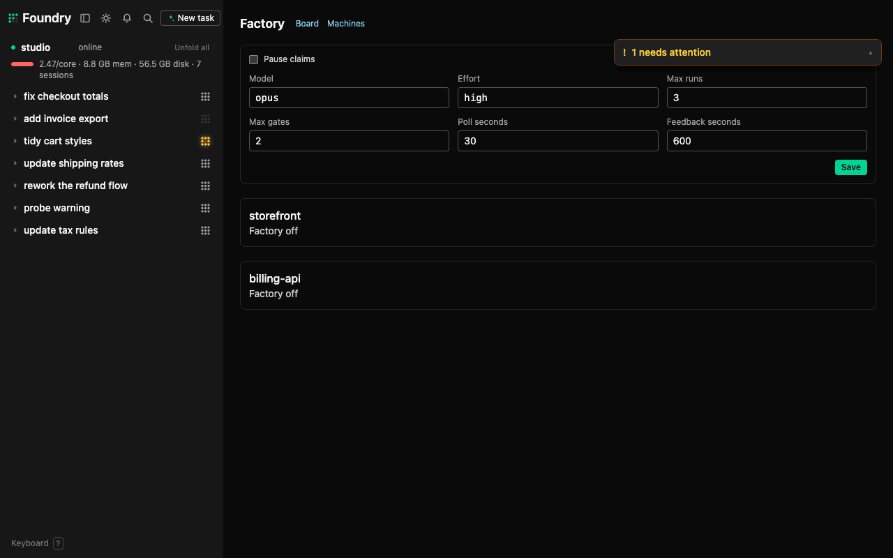
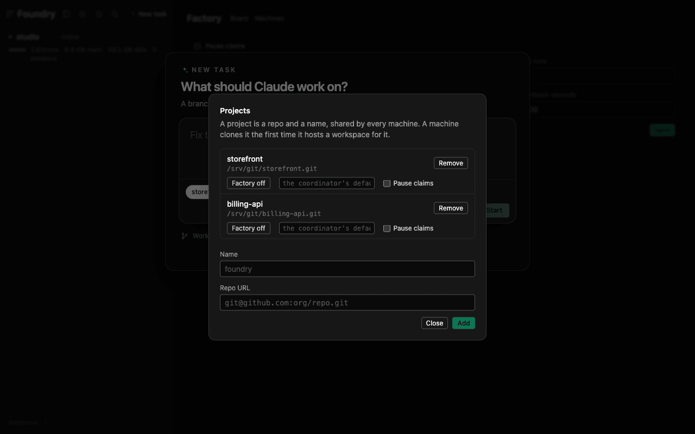
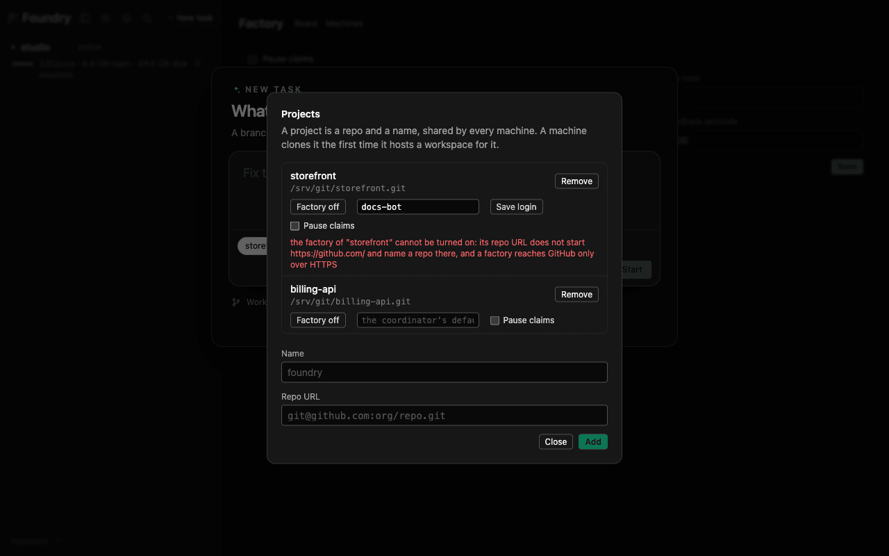
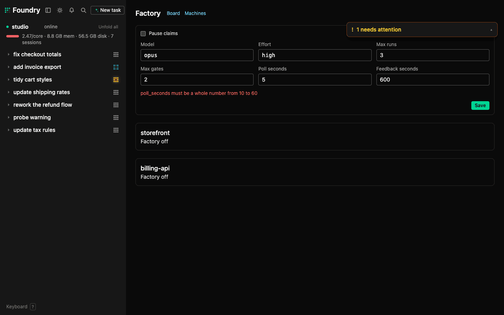

# The factory

The factory builds GitHub issues for you. For each project that has its factory on, Foundry claims the issues labelled `factory:ready`, builds each one in a workspace on a machine of the fleet, and opens a pull request. The Factory view shows what it is doing, turns each project's factory on or off, and holds the settings for the whole fleet.

Open it from the factory icon near the top of the rail. To get the rail, collapse the sidebar with `Cmd+B`, or `Ctrl+B` outside a terminal. A narrow screen has no rail, so add `/factory` to Foundry's address there. The view's **Board** and **Machines** links take you back.

Before a project can use the factory, a machine needs a GitHub token and the build skill. You set those up on the machine itself, as [Set up the factory](../install.md#set-up-the-factory) describes.

## The line

The view opens on the line: four stations an issue moves along, **Ready**, **Building**, **Held up** and **Finished**, with how many issues stand at each across every project whose factory is on. A station with nothing at it is grey, and Building's dot pulses while a run builds. Under it, `across 2 of 3 projects` says how many projects it counts, and an amber `Claims are paused for every project` shows while the fleet's claims are paused.

With no project on, the line stands empty and says what the factory does and what a project needs before you turn it on.

## Turn a project's factory on

You turn a project's factory on in its section of the Factory view, or in the **Projects** dialog. To open the dialog, click the board's task line, or open the New task dialog, then click **Projects**. Both show the same controls.

Each project has three controls:

- **Factory off** or **Factory on**. A switch. Click it to turn the project's factory on or off.
- The login box. The GitHub account the factory acts as for this project. Leave it blank and the factory takes the coordinator's default login when you turn it on. To use another account, type it and click **Save login**, which shows once you type. The switch always sends the saved login, never one you typed but did not save. The factory pushes and comments as this login, so a machine needs a token for it.
- **Pause claims**. Stops the project from claiming new issues. A project that is on keeps its login when you pause or resume it.

The project's repo must be a `https://github.com/<owner>/<repo>` URL. If it is not, the switch refuses, and the dialog says why under the project. Other hosts and SSH URLs (`git@github.com:…`) do not work with the factory. Turning it on with no login saved, when the coordinator has no default login, is refused as well.

The repo also needs a `.dw/config.yml` on its default branch. [Turn a project's factory on](../install.md#turn-a-projects-factory-on) lists what it must hold. If the file does not load, the project stays idle and a `factory_idle` item appears on the [attention list](board.md#when-something-needs-you), naming the reason.

## Settings for the whole fleet

Under the line, **Settings for every project** shows them all on one line, such as `opus · high effort · 2 runs at once · 3 gates at once · looks every 30s · feedback every 300s`. Click it to open the form. The form applies to every project.

- **Pause claims**. Stops every project from claiming new issues.
- **Model** and **Effort**. What each build session starts with. Each is one word.
- **Max runs**. How many issues the factory works on at once, from its claim until its pull request.
- **Max gates**. How many gates, the checks that test a build, run at once.
- **Poll seconds**. How often the factory looks for new issues, from 10 to 60.
- **Feedback seconds**. How often the factory looks for new comments on a pull request that is open.

Click **Save**. The form checks every field before it sends and says what is wrong, so a poll of 5 stops with `poll_seconds must be a whole number from 10 to 60`. The daemon can still refuse a change, and its reason shows in the same place.

## What each project shows

Each project has a section under the settings, with its name, its controls, and, when its factory is on, its own line beside the name (`2 Ready › 1 Building › 1 Held up › 2 Finished`) and **Claims paused** while its own claims are paused. With it on, the next lines say what the factory is doing for that project:

- `Holds the lease at generation 3, on studio`: one machine runs the factory for each project, and this says which. The generation goes up each time that role changes hands.
- `Idle: …`: the factory is not working, and says why, for example that GitHub failed several passes in a row.
- `Idle here: studio holds the lease at generation 3`: the machine you are on is not the one running it.
- `Idle: this coordinator holds no token for docs-bot`: the machine that should run it has no token for the project's login. Add the token as [Set up the factory](../install.md#github-tokens-and-the-default-login) describes.
- `No status yet`: the factory has not reported yet.

Under those lines, when there is something to show, come the line's four stations side by side, each saying `Nothing building` and so on when it is empty. On a narrow screen they stack.

- **Ready**: issues waiting to be claimed, each with the reason it has not started. Under them, **Feedback waiting**: pull requests with new feedback whose round has not started yet, each with the reason it waits.
- **Building**: each live run, with its issue, the step it is on, the machine, the attempt, the gate retries used, the minutes so far, and a link to its workspace. Click the workspace to open its terminal. A run whose workspace has not reached this page yet says `workspace not here yet`.
- **Held up**: runs that are **stuck** or **needs info**, with the reason. A stuck run keeps its workspace until the issue leaves stuck, and any uncommitted work in it is lost then.
- **Finished**: the last 20 finished runs, with the outcome and a **PR** link when there is one.

Issue numbers link to the issue on GitHub.

## Stop a run

On a live run, click **Stop**. The row asks `Stop run #12? It goes stuck on the holder's next pass.` Click **Stop the run** to confirm, or **Cancel**. The factory marks the run stuck on its next pass, so it does not stop that second. Foundry shows the answer next to the button, or the reason it refused, for example when the run is not building any more.
