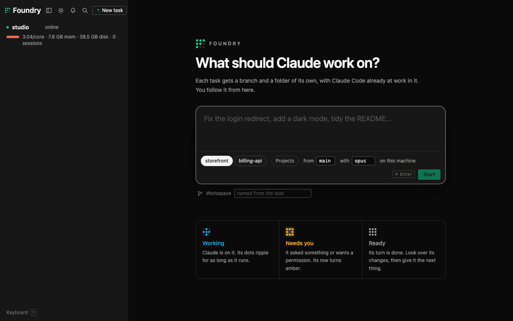
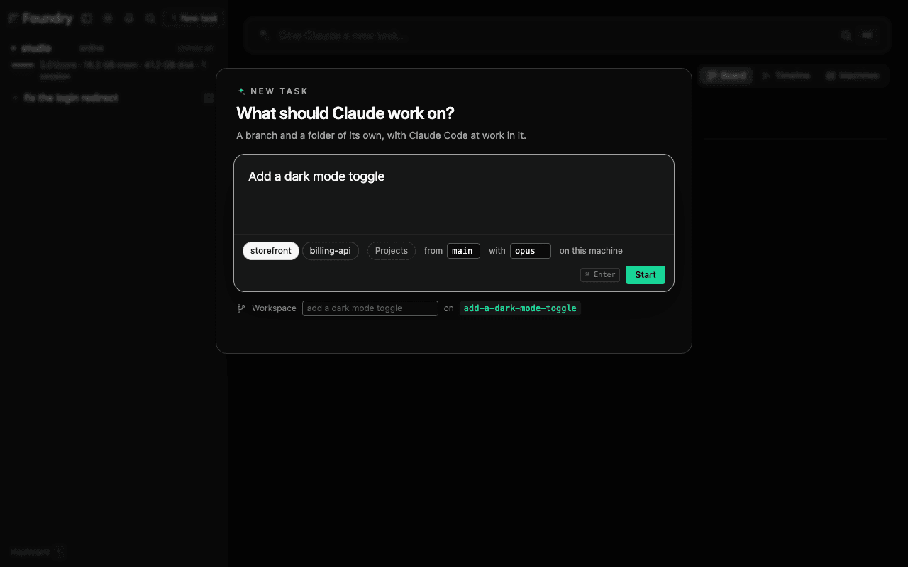
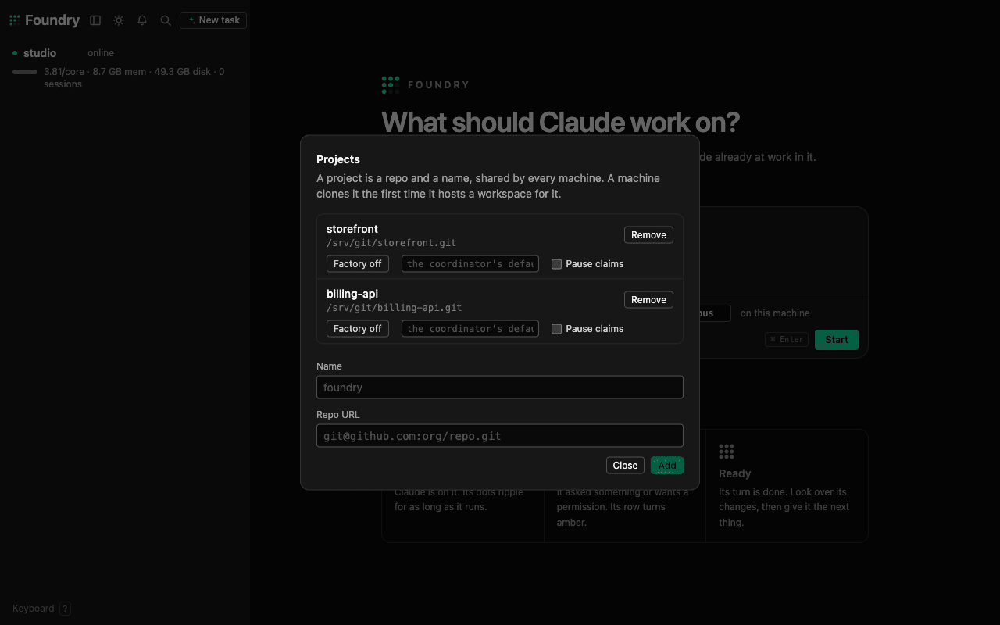

# Getting started

Foundry runs Claude Code on tasks for you, each in a workspace of its own, and shows them all in one page. This page covers opening that page, starting your first task, and starting every task after it.

## Open the UI

Open Foundry's address in a browser. [Open the UI](../install.md#open-the-ui) in the install guide gives the address, and says how to reach it from another device.

A fleet with no workspaces opens on the first-run screen. Once any workspace exists, the page opens on [the board](board.md) instead.

## The first-run screen

The first-run screen asks one question: **What should Claude work on?**

Type the task in the box. Write it the way you would tell a colleague. As you type, Foundry names the workspace and its branch from your words, and shows the branch under the box. "Fix the login redirect" becomes the workspace `fix the login redirect` on the branch `fix-the-login-redirect`. A link to a GitHub pull request or issue becomes `pr` or `issue` and its number, other links are left out, and a slash command loses its slash: "/review-loop https://github.com/o/people-hub/pull/1181" becomes `review-loop pr 1181`, numbered `review-loop pr 1181 2` when the repo already has the branch `review-loop-pr-1181`.

Under the box, from left to right:

- **Project.** One button per project. The first one is picked. Pick the repo the task belongs to. **Projects** next to them opens the project list, described below.
- **from.** The base branch the new branch starts from. It starts as `main`.
- **with.** The model Claude Code runs on. It starts as `opus`. Type another, or pick one from the suggestions: `opus`, `sonnet` and any model a session already runs.
- **on.** Only appears when the fleet has other machines. Choose **this machine**, **let Foundry choose**, or a machine by name. An offline machine is listed but cannot be picked. With no other machine, the line just says "on this machine".
- **Start.** Makes the workspace and starts Claude. `Cmd+Enter` (`Ctrl+Enter` on Windows and Linux) does the same from the box.

The **Workspace** field under the box holds the name. Leave it empty to use the one made from the task, or type your own. Foundry numbers a name made from a task when the project already has its branch, so a second "fix the login redirect" becomes `fix the login redirect 2`. It never changes a name you typed. If the project already has a workspace on that name's branch, the branch turns amber, a line asks for another name, and **Start** stays off.

The task is optional. With a name and no task, Foundry makes the workspace and starts Claude with nothing to do yet.

Below the box, the screen explains the three states every session shows: **Working**, **Needs you** and **Ready**. The board, the sidebar, the tab icon and every notification use them. [Session states](sessions.md#session-states) says what each one means and what to do.

## After you press Start

While Foundry works, a line under the box says what it is doing: "Making fix-the-login-redirect from main…", then "Starting opus on your task…".

When it finishes, you have:

- A workspace with its own git branch and its own folder, made from the base branch you chose.
- Claude Code already running in that folder, with your task as its first prompt.
- The session's terminal open on screen, where you can watch Claude work or type to it. See [Working in a terminal](sessions.md).

If the workspace was made but its session did not start, the box stays on screen and says why. The workspace exists, so a second try would only find its name taken. **Go to the board** under the message takes you on. If the daemon only has a warning about the workspace's setup, you still land in the session, and an amber card at the top right keeps the message until you press **Dismiss**.

If you chose **let Foundry choose** and no machine can take the task yet, nothing opens. The task waits in a **waiting for a machine** card, and starts as soon as a machine qualifies. [Let Foundry choose a machine](machines.md#let-foundry-choose-a-machine) explains the card.

## Start any later task

Once the first workspace exists, there are three ways to start a task. All three use the same box, with the same project, base, model and name fields.

- **New task** in the sidebar, or the sparkle button on the rail, opens the New task dialog.
- The line at the top of the board, **Give Claude a new task…**, is the same box in one line. Click it and it opens to show the project, base, model and **Start**. `Esc` in the empty line leaves it.
- The jump palette. Type a few words and pick the last row, **New task "your words"**. It opens the dialog with those words as the task. See [Jump to anything](board.md#jump-to-anything).

The dialog opens over whatever you were looking at. **Start** closes it and takes you to the new session. If the daemon has something to say about the workspace's setup, the dialog stays open with the message and a **Close** button. `Esc` closes it without starting anything.

## Projects

A project is a repo and a name, shared by every machine in the fleet. A machine clones the repo the first time it hosts a workspace for that project.

**Projects** in the task box opens the list.

- **Add a project.** Fill in **Name** and **Repo URL** and press **Add**. The new project shows up in the task box and is picked for you. If the daemon refuses, a red line under the form says why, and what you typed stays.
- **Remove a project.** Press **Remove** beside it, then **Remove from every machine** to confirm. **Cancel** backs out. Foundry refuses while a live workspace made from the project exists, and says so beside the project.
- **Close** leaves the dialog and clears anything half typed.

With no projects at all, the task box says "No projects yet" and offers **Add a project**.

Each project row also has the factory controls: a switch, the GitHub login it acts as, and a pause. They are covered in [The factory](factory.md).

## Where next

- [The board and the sidebar](board.md): every workspace at a glance, the sidebar, notifications and the jump palette.
- [Working in a terminal](sessions.md): working inside one session or shell.
