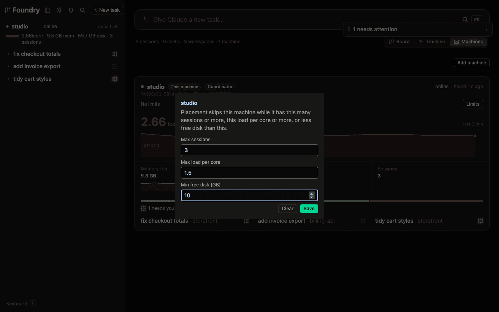
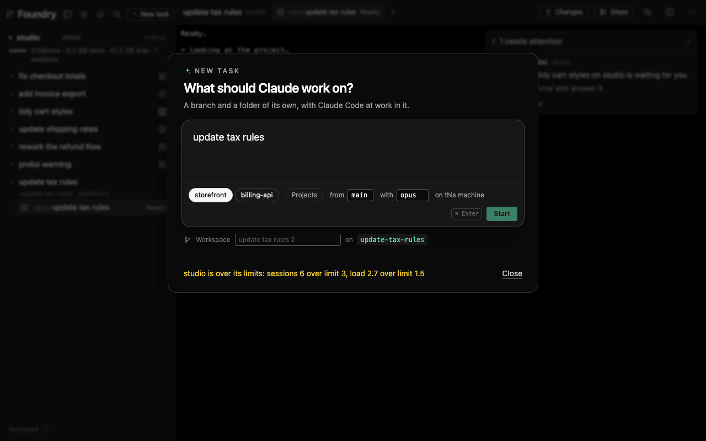
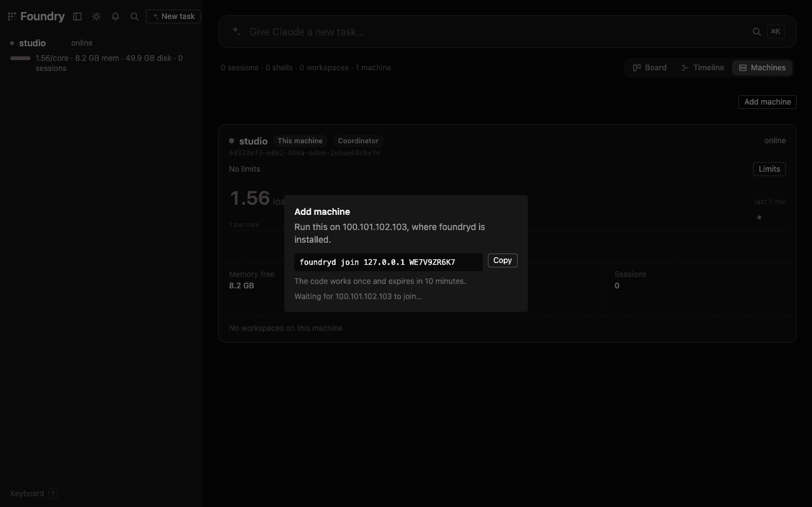
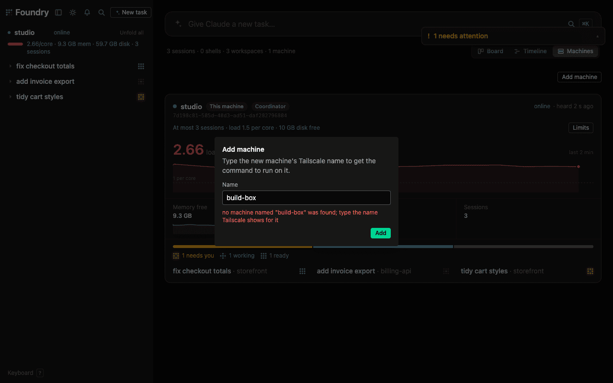

# Machines

The machines view shows every machine in your fleet as a card: whether it is online, how busy it is, and what runs on it. It is also where you add a machine, set its limits and take it out of the fleet.

Open it from the **Machines** switch at the top right of the board, beside **Board** and **Timeline**. A machine's name in the sidebar, or its dot on the rail, opens it too.

## Read a machine's card

Each card holds:

- **Name and status.** A green dot and `online`, with how long ago the page last heard from the machine, such as `heard 4 s ago`. Or a red dot and `offline`. **This machine** marks the machine whose page you are on. **Coordinator** marks the machine that holds the coordinator role now: every change to the fleet's shared settings goes through it.
- **Load per core.** The big number is the machine's load divided by its cores. It turns amber from 0.70 and red at 1.00 or more. The graph under it covers the last ten minutes, or the time since you opened the page if that is shorter, and the dashed line is 1.00. The page draws what it has seen since it opened, so a fresh page starts with a short line.
- **Memory free**, **Disk free** and **Sessions.** Free memory has its own small graph. **Sessions** counts the sessions running on the machine.
- **Terminals by state.** A bar and a count for each state: needs you, working, ready and so on, most urgent first.
- **Workspaces.** One row per workspace, with its project and a glyph per terminal. Click a row to open its most urgent terminal.

A machine that goes offline keeps its card, greyed, with the numbers it last reported. Its terminals count as unreachable until the machine is heard from again. A machine that has sent no numbers yet shows **No sample yet**.

If your browser loses its link to the daemon, a notice at the top says the numbers are the last this page saw.

## Rename a machine

Click the machine's name on its card and type a new one. Press `Enter` to save or `Esc` to cancel. The new name shows on every machine once the fleet has it. To rename from the sidebar, point at the machine's name and click the pencil. A machine that has not yet joined the machine list cannot be renamed.

## Set a machine's limits

Limits keep a machine from taking more than you want. The line under the name says what is set: `At most 3 sessions · load 1.5 per core · 10 GB disk free`, or **No limits**.

Click **Limits** to change them.

- **Max sessions**. The machine counts as full at this many sessions.
- **Max load per core**. It counts as full at this load or higher.
- **Min free disk (GB)**. It counts as full with less free disk than this.

Fill in all three and click **Save**, or click **Clear** to remove every limit. Foundry refuses a value that does not fit, such as 0 sessions, a load of 0 or a blank field, and the dialog says why.

A machine at or over a limit is skipped when you let Foundry choose a machine for a new task. If you pick the machine yourself, the task still starts, and the New task box tells you so.

## Let Foundry choose a machine

When the fleet has more than one machine, the New task box has an **on** menu: **this machine**, **let Foundry choose**, or a machine by name. An offline machine is listed but cannot be picked. With **let Foundry choose**, Foundry picks the online machine under all its limits with the lowest load per core. Fewer sessions breaks a tie.

If no machine qualifies, the task waits. A card headed **N waiting for a machine** appears at the top right of the page, or folded at the top on a narrow screen. Each waiting task lists why every machine was passed over, for example `old-mini: offline` or `trilogy-mac: load 1.8 over limit 1.0`, and how long it has waited. Foundry tries again every second, and the task starts as soon as a machine qualifies. Click **Cancel** to drop a waiting task. If the start fails, the card says why and shows **Dismiss** instead. A task that waits more than five minutes also raises a **Placement waiting** item on the attention card.

Only the machine you started the task from holds the waiting list, so only its page shows the card. If that machine's daemon stops, the waiting tasks are dropped.

## Add a machine

Install `foundryd` on the new machine first, and make sure it is on the same Tailscale network as the fleet. [Add a machine](../install.md#add-a-machine) has the commands.

1. On the machines view, click **Add machine**.
2. Type the new machine's Tailscale name, for example `build-box`, or its Tailscale address, and click **Add**.
3. The dialog shows one command to run on the new machine. Click **Copy** and run it there. The code works once and expires in 10 minutes.
4. The dialog says it is waiting for the machine to join, for example `Waiting for build-box to join…`, and says `build-box joined` once it has. Its card then appears.

If Tailscale does not know the name, the dialog says so and keeps what you typed.

It refuses the same way for a name a machine in the fleet already has, or one that resolves to a machine already in the fleet. Closing the dialog forgets the command. Open it again for a new code.

The card shows the machine under its own Tailscale name, which can differ from what you typed. Rename it if you want something else.

## Change the coordinator order

With two or more machines, each card shows `Coordinator order 1 of 2`, with up and down arrow buttons. The cards run in this order, and it is the order in which machines take the **Coordinator** role. Click an arrow to swap a machine with its neighbour. The arrows wait until the new order shows before they accept another move.

## Remove a machine

On the card of any other machine, click **Remove from fleet** and confirm with **Remove from fleet** again. The dialog warns that the machine will be cut off from every machine and cannot join again under its current identity. Its workspaces stay on its own disk.

You cannot remove the machine whose page you are on, so its card has no such button. Open the page of another machine in the fleet to do it. [Remove a machine](../install.md#remove-a-machine) says what happens to the removed machine.

A removal cannot be undone, and for now a removed machine cannot rejoin.
