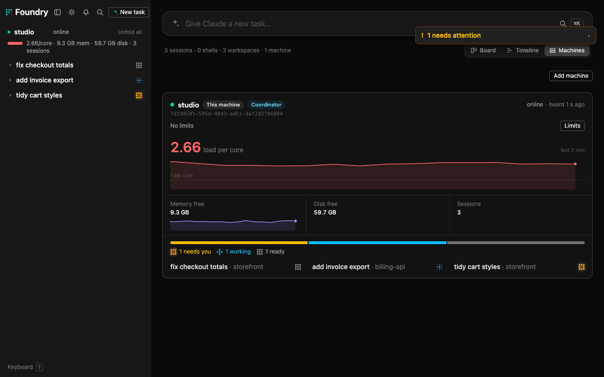

# Machines

The machines view shows every machine in your fleet as a card: whether it is online, how busy it is, and what runs on it. What you change lives in Settings: **Settings → Machines** holds the coordinator order, **Add machine** and the release checklist, and each machine has its own page there for its name, its limits, its waiting release and removing it.

Open the machines view from the **Machines** switch at the top right of the board, beside **Board** and **Timeline**. A machine's name in the sidebar opens that machine's page in Settings.

## Read a machine's card

Each card holds:

- **Name and status.** A green dot and `online`, with how long ago the page last heard from the machine, such as `heard 4 s ago`. Or a red dot and `offline`. **This machine** marks the machine whose page you are on. **Coordinator** marks the machine that holds the coordinator role now: every change to the fleet's shared settings goes through it. **Settings**, at the right, opens the machine's page in Settings.
- **Version, limits and order.** The version the machine runs, with any release waiting on it, such as `Version 0.9.0 · v0.9.1 waiting`. Its limits, such as `At most 3 sessions · load 1.5 per core · 10 GB disk free`, or **No limits**. With two or more machines, its place in the coordinator order, such as `Coordinator order 1 of 2`.
- **Load per core.** The big number is the machine's load divided by its cores. It turns amber from 0.70 and red at 1.00 or more. The graph under it covers the last ten minutes, or the time since you opened the page if that is shorter, and the dashed line is 1.00. The page draws what it has seen since it opened, so a fresh page starts with a short line.
- **Memory free**, **Disk free** and **Sessions.** Free memory has its own small graph. **Sessions** counts the sessions running on the machine.
- **Terminals by state.** A bar and a count for each state: needs you, working, ready and so on, most urgent first.
- **Room for the next task.** **Foundry's pick** if a task Foundry places would go to this machine now, **Has room** if it is online and under its limits, or **Full** with the limits it is at or over, such as `load 1.8 over limit 1.5`. **New task here** opens the New task box set to this machine.
- **Workspaces.** One row per workspace, with its project and a glyph per terminal. Click a row to open its most urgent terminal.

A machine that goes offline keeps its card, greyed, with the numbers it last reported. Its terminals count as unreachable until the machine is heard from again. A machine that has sent no numbers yet shows **No sample yet**.

If your browser loses its link to the daemon, a notice at the top says the numbers are the last this page saw.

## Settings → Machines and a machine's page

Open Settings with the gear in the sidebar header, or `Cmd+,` (`Ctrl+,` on Windows and Linux), and pick **Machines**. The header's release badge opens it too. **Settings → Machines** shows:

- **Coordinator order**: the machines in the order they take the coordinator role, each name a link to its page. See [Change the coordinator order](#change-the-coordinator-order).
- **Add machine**. See [Add a machine](#add-a-machine).
- **Install the waiting release**. See [Install a waiting release](#install-a-waiting-release).

On a wide screen, Settings lists each machine under **Machines**, marked `offline`, `update ready` or `coordinator` when one applies. Click it for the machine's page. A card's **Settings** link and the machine's name in the sidebar open the same page. It shows, in this order:

- **Update**, only while a release is waiting on the machine. See [Install a waiting release](#install-a-waiting-release).
- **In the shared settings**: the machine's name and limits.
- **Remove from the fleet**, except on the machine serving the page and on a machine not in the machine list yet. See [Remove a machine](#remove-a-machine).

The page of a machine the fleet does not hold says so, with a link back to **Settings → Machines**.

## Rename a machine

On the machine's page, type the new name in **Name**. The change is not sent at once: a bar at the foot of the page lists it, such as `1 change · Name studio → desk`, with **Discard** and **Save 1 change**. Click **Save**. The new name shows on every machine once the fleet has it. A machine that has not yet joined the machine list cannot be renamed, so its fields are locked.

## Set a machine's limits

Limits keep a machine from taking more than you want. Its card says what is set: `At most 3 sessions · load 1.5 per core · 10 GB disk free`, or **No limits**.

Change them on the machine's page, under **In the shared settings**:

- **Max sessions**. Placement skips the machine while it has this many sessions or more.
- **Max load per core**. Placement skips it at this load per core or more.
- **Min free disk (GB)**. Placement skips it with less free disk than this.

Each edit joins the bar at the foot of the page as old → new, beside a new name, and **Save** sends them. Give all three. **Clear limits** empties the fields, and the bar shows that as one change to `none`. Foundry refuses a value that does not fit, such as 0 sessions, a load of 0 or a blank field, and the row says why. The fields can be changed while the machine is offline: the fleet's coordinator keeps them.

If someone else changes a field you are editing, its row says so and names the new value, and Save reads **Look again**. Press it, check the row, then press Save. Leaving the page with changes not saved asks first.

A machine at or over a limit is skipped when you let Foundry choose a machine for a new task. If you pick the machine yourself, the task still starts, and the New task box tells you so.

## Let Foundry choose a machine

When the fleet has more than one machine, the New task box has an **on** menu: **this machine**, **let Foundry choose**, or a machine by name. An offline machine is listed but cannot be picked. With **let Foundry choose**, Foundry picks the online machine under all its limits with the lowest load per core. Fewer sessions breaks a tie.

With more than one machine, the top of the machines view tells you where such a task would go now, for example `studio takes the next task`, and how many machines have room. If none has, it says **No machine has room** and lists why each was passed over. Its **New task** button opens the New task box set to **let Foundry choose**. It works from each machine's last numbers, so a task already on its way to a machine can still change the pick.

If no machine qualifies, the task waits. A card headed **N waiting for a machine** appears at the top of the page, folded to its count. Click it to unfold it. Each waiting task lists why every machine was passed over, for example `old-mini: offline` or `trilogy-mac: load 1.8 over limit 1.0`, and how long it has waited. Foundry tries again every second, and the task starts as soon as a machine qualifies. Click **Cancel** to drop a waiting task. If the start fails, the card says why and shows **Dismiss** instead. A task that waits more than five minutes also raises a **Placement waiting** item on the attention card.

Only the machine you started the task from holds the waiting list, so only its page shows the card. If that machine's daemon stops, the waiting tasks are dropped.

## Add a machine

Install `foundryd` on the new machine first, and make sure it is on the same Tailscale network as the fleet. [Add a machine](../install.md#add-a-machine) has the commands.

1. Open **Settings → Machines** and click **Add machine**.
2. Type the new machine's Tailscale name, for example `build-box`, or its Tailscale address, and click **Add**.
3. The dialog shows one command to run on the new machine. Click **Copy** and run it there. The code works once and expires in 10 minutes.
4. The dialog says it is waiting for the machine to join, for example `Waiting for build-box to join…`, and says `build-box joined` once it has. The machine then shows in the coordinator order, and its card in the machines view.

If Tailscale does not know the name, the dialog says so and keeps what you typed. It refuses the same way for a name a machine in the fleet already has, or one that resolves to a machine already in the fleet. Closing the dialog forgets the command. Open it again for a new code.

The card shows the machine under its own Tailscale name, which can differ from what you typed. Rename it if you want something else.

## Change the coordinator order

**Settings → Machines** lists the machines under **Coordinator order**, first first, and marks the one that holds the **Coordinator** role now. The first machine online in this order coordinates the fleet. With two or more machines, click a machine's ↑ or ↓ to swap it with its neighbour. The arrows wait until the new order shows before they accept another move. Each card in the machines view shows its place, such as `Coordinator order 1 of 2`.

## Install a waiting release

Each machine looks for a newer release on its own and keeps it waiting until you install it. While one waits, a badge at the top of the page names it, such as `Release waiting: v0.9.1 on 3 machines`. Click it to open **Settings → Machines**, where **Install the waiting release** lists each machine with a release waiting, ticked. Untick any you want to leave out and click **Install**. Each machine installs the release shown for it and restarts, and its terminals keep running. The machine serving the page goes last, so its restart cuts off no other install. Each row then says what became of its install, such as **Restarting**, and **Done** puts the list back. Install waits while an install is still out, or while the machine serving the page restarts.

A machine's own page has the same install for that machine alone: under **Update** it says `v0.9.1 is ready`, with **Install**. On the machine serving the page it first says that the machine restarts. [Updates](../install.md#updates) has the rules.

## Remove a machine

Open the page of the machine to remove and click **Remove from fleet**, then confirm with **Remove from fleet** again. The dialog warns that the machine will be cut off from every machine and cannot join again under its current identity. Its workspaces stay on its own disk.

You cannot remove the machine serving the UI you have open, so its page has no such section. Open the UI of another machine in the fleet to do it. [Remove a machine](../install.md#remove-a-machine) says what happens to the removed machine.

A removal cannot be undone, and for now a removed machine cannot rejoin.
