# Working in a terminal

A terminal is where you talk to Claude Code, watch what it does, read its changes and answer it. Open one from the board, the sidebar or the jump palette. See [The board and the sidebar](board.md).

## The header

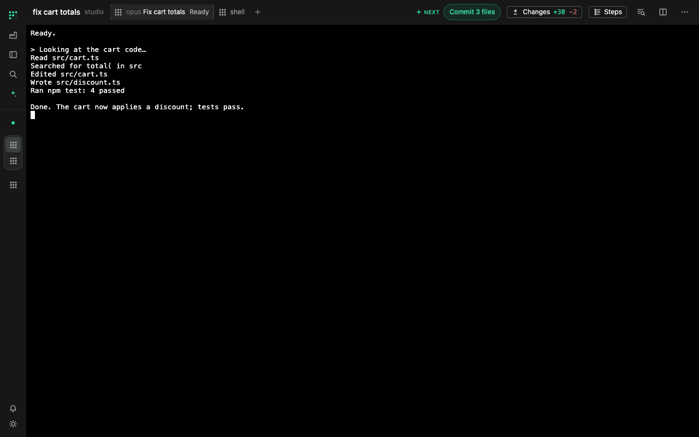

One bar runs along the top of the terminal. From left to right:

- The workspace name, then the machine it runs on. Point at the name to see its branch and project.
- One tab for each terminal in the workspace, sessions first, then shells. Click a tab to switch. The tab you are on shows its state. When a tab in the background changes state, it shows the new state in bold until you open it.
- A **+** that starts another terminal in this workspace. See [Start a session or a shell](#start-a-session-or-a-shell).
- **Changes**, which opens what the workspace changed. Once you have opened it, the button also shows how many lines were added and removed.
- **Steps**, **Find** and a split button. **More**, the three dots, holds the rest.

On a phone the bar also has a button that opens the workspaces list, and a **Jump to** button.

When the bar is short of room, for example with the sidebar and Steps both open, what you need least gives way first, so nothing spills out of the bar. The next steps go first, then the machine name. Next, **Changes** and **Steps** shrink to their icons. At its narrowest, as on a phone, **Changes** and **Steps** move into **More**, and two or more tabs get a row of their own. The workspace name and the tab you are on always stay.

**+** only shows for workspaces on this machine. For a workspace on another machine, the menu also leaves out the entries that start a session or a shell.

## Sessions and shells

A session is Claude Code. A shell is a plain command line in the same worktree, for running tests, checking git or making an edit yourself. Both show in the tab strip and the sidebar, and both take typing: click in the terminal and type.

Only a session reports what it is doing. A shell shows **Open** while it is open, **Ended** after a clean exit and **Failed · exit N** after any other.

### Start a session or a shell

Press **+**, then choose:

- **New session…** asks for a **Model**, which starts as `opus`, and an optional **First prompt**. If you write one, Claude starts on it the moment it opens. `Cmd+Enter`, or `Ctrl+Enter` elsewhere, starts the session from the prompt box.
- **New shell** opens a shell at once and takes you to it.

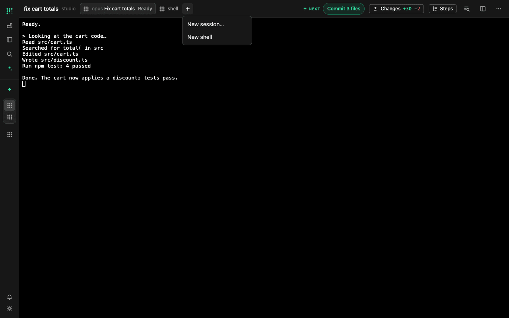

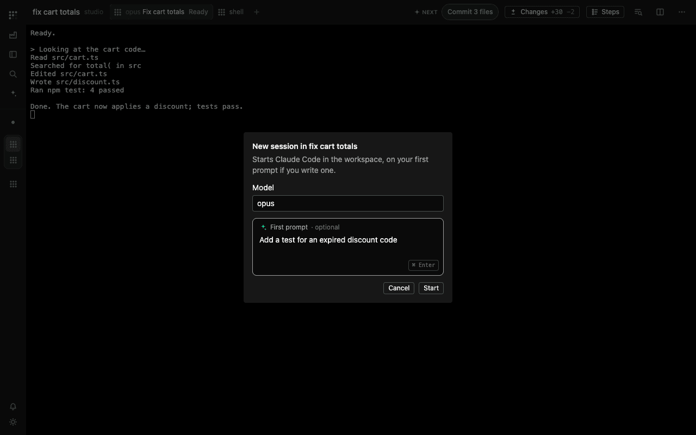

### Rename a session

A session shows its first prompt beside its model until you name it. Double-click the name in the sidebar or in the tab strip, or pick **Rename** in the terminal's menu anywhere it is listed. Type the name and press `Enter`; `Esc` puts the old one back. The name shows everywhere the session is listed, on every machine. Clear the field and press `Enter` to go back to the first prompt. A shell keeps its name.

## Go through what needs you

While any session needs you, an amber strip heads every page: the board, the timeline, the machines, the factory and an open terminal. It says how many need you, then the workspace of the next one and what it asks. Click it, or press `Cmd+J` anywhere, to open that one. Answer it, then click the strip or press `Cmd+J` again for the one after. Over a terminal that still needs you, the strip counts the others as "1 more needs you" and stays quiet. Once you have answered, it fills and glows once. The order is the board's. After the last, `Cmd+J` goes round to the first.

## Session states

The tab, the sidebar and the board all show a session's state the same way. Three states matter most.

| State | What it means | What to do |
| --- | --- | --- |
| **Working** | Claude is in the middle of a turn. | Nothing. Watch the terminal or open **Steps**. |
| **Needs you** | Claude asked a question or wants permission. | Open the terminal and answer. On a phone the key bar offers **1**, **2** and **3**. The strip at the top of the page goes on to the next one. |
| **Ready** | The turn is done and Claude waits for your next prompt. | Type a prompt, or pick a next step. |

You may also see **Starting**, before the session has reported anything, and **Stuck**, after ten minutes with no output. Open a stuck session and see what it is doing. **Failed** and **Ended** mean it stopped. **Unreachable** means its machine cannot be reached right now.

## Steps

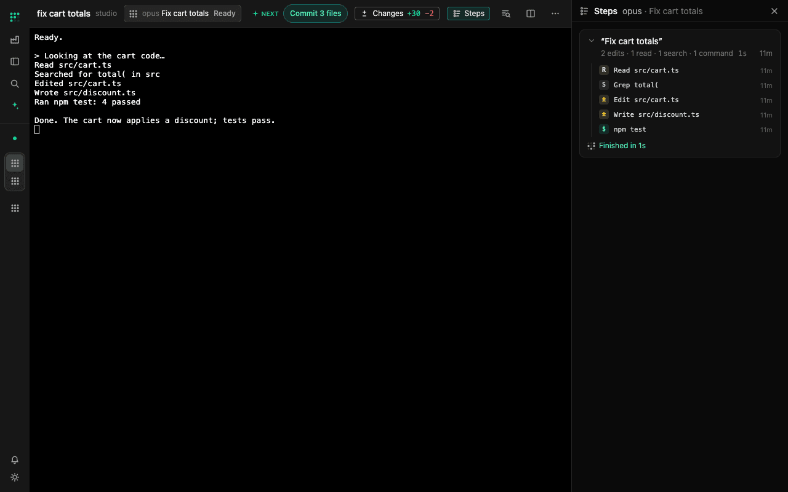

**Steps** shows a session's story in a column on the right, turn by turn. It stays open as you move between terminals and follows whichever one you are on, until you close it with the **x**.

Each turn is a card. It starts with your prompt, then lists every tool call and every question Claude asked, each with how long ago it happened. Earlier turns fold up to their prompt, a count such as "2 edits · 1 read · 1 command" and how long they took. Click a card to open or fold it. The newest turn stays open and grows as Claude works, and the column keeps the newest step in view unless you scroll up.

Each step has a small mark: `$` for a command, `±` for an edit or write, `R` for a read, `S` for a search, `W` for a web look-up, `A` for a sub-agent and `?` for a question. Click an edit to open that file's diff in **Changes**.

Switch from **Turns** to **Files** to see the same steps by what they touched. Every file Claude read or changed is listed once, changed files first, with how many edits and reads. A file with changes shows its lines added and removed, and clicking it opens its diff. Below the files come the commands Claude ran and its other tools, each once, with how many times. Each row has a strip with a tick wherever along the session it was touched, and a gap where a new turn starts, so a file edited early and again at the end, or a test run four times, shows at a glance. Your choice of **Turns** or **Files** is kept in this browser.

A shell has no steps. Open a session to follow what it does. On a phone Steps takes the whole screen.

Only the machine that runs a session keeps its steps, and only since its daemon last started. For a session on another machine, or one that began before a restart, Steps says it cannot show them.

## Find in the scrollback

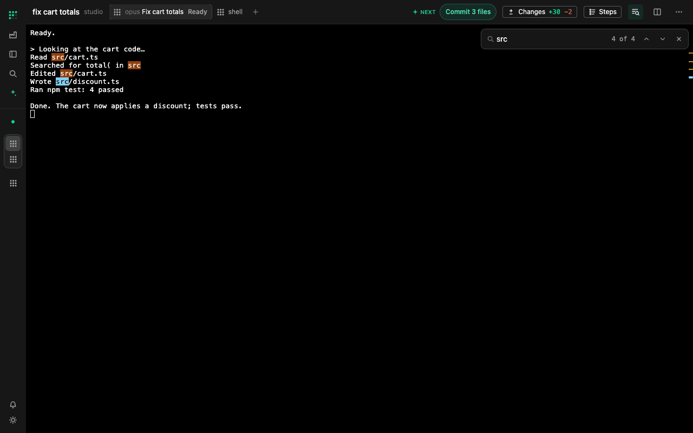

Press `Cmd+F` to search everything the terminal has kept, not only what is on screen. Outside the terminal, `Ctrl+F` does the same. Inside the terminal, `Ctrl+F` stays with your shell, so use the **Find** button there if you are not on a Mac.

Type, and every match lights up, the one you are on brighter than the rest. The bar says "3 of 12" or **No matches**.

- `Enter` goes to the older match. `Shift+Enter` goes to the newer one.
- The marks along the right edge show where matches sit. Click one to jump to it.
- New output updates the matches while the bar is open.
- `Esc` closes it and gives the keyboard back to the terminal.

On a narrow screen there is no Find button in the header. Use **Find in scrollback** in the **More** menu.

## Changes

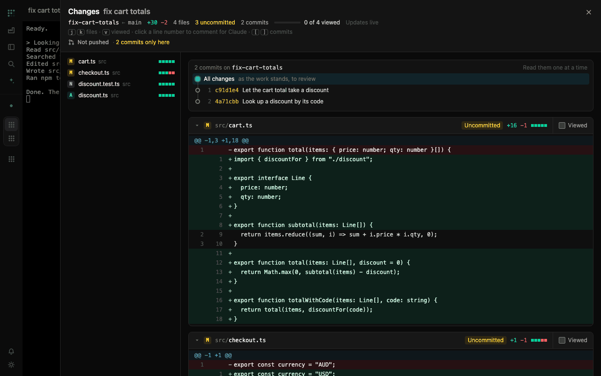

**Changes** opens a sheet with everything the workspace changed since it left its base branch, committed or not. It reads the changes again every 3 seconds, so you see edits as Claude makes them.

Only the machine that holds a workspace can read its changes. For a workspace on another machine, the sheet says it could not read them. Open that machine's own UI to see them.

The top shows the branch and its base, the lines added and removed, the file count, how many files are **uncommitted** and how many commits there are. Below it is a list of files and each file's diff. A letter beside each file says whether it was added, modified, deleted or renamed, or is new and not yet in git. Each diff is coloured as code in its file's language. Where a line was changed rather than added, the words that changed are marked on the old line and the new one.

Once the branch has something to say, one line under the title tells where it stands. It reads **Not pushed** with how many commits are only on this machine, **Pushed**, a draft or open **PR #n** with its checks and review, or **PR #n merged**. Checks read **Checks running**, **Checks pass** or **Checks failing**. The review reads **Review required**, **Approved** or **Changes requested**. The pull request's number links to GitHub.

### Review a change

- `j` and `k` move to the next and previous file.
- `v` marks the file **Viewed**, folds it and moves to the next one you have not viewed. You can also tick the box on the file. The sheet counts "2 of 4 viewed".
- If Claude changes a file you have viewed, the file opens again, says it changed since you viewed it and marks the new lines. This browser remembers what you have viewed.
- A file with more than 400 diff lines starts folded.

### Read the branch commit by commit

When the branch has commits, a list of them sits above the diff. Choose one to see only what it changed. `]` goes to the next commit and `[` to the previous one. Going back past the first commit shows all changes again. Commits are only for reading. You cannot mark them viewed or comment on them.

### Comment on a line

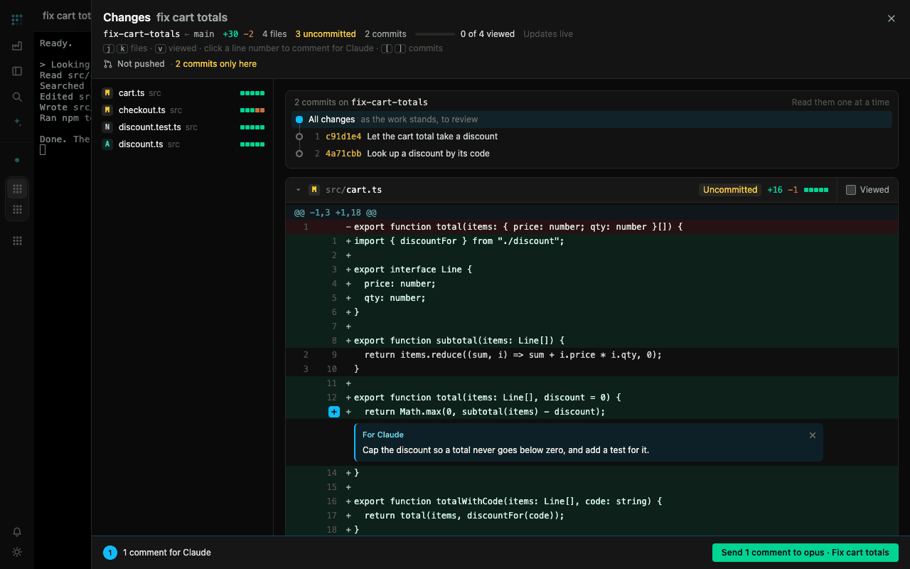

Click a line number, or tap it on a phone, to write a note for Claude on that line. **Add comment**, or `Cmd+Enter` (`Ctrl+Enter` elsewhere), adds it and `Esc` drops it. Click a saved comment to change it, or its **x** to delete it. Add as many as you like.

The bar at the bottom says how many comments you have and which session takes them. The green button, **Send 1 comment to** and the session's name, types them into that session as one message. Only a session that is **Ready** can take them, so a turn in progress or a question on screen is never answered by accident. If it is not ready, the bar says what it is doing and waits. With more than one session you pick which one from the list.

Comments live only until you reload the page. If Claude has since changed a commented line, the comment says so.

## Next steps for an idle session

When a session on this machine is **Ready**, Foundry looks at its workspace and offers the next move as green chips marked **Next**. Pressing a chip sends Claude a prompt that asks for it. You may see:

- **Commit 3 files**, when there are uncommitted changes.
- **Push and open a PR** or **Open a PR**, when everything is committed, the branch has commits of its own and it has no pull request yet.
- **Fix failing checks**, in red, when the pull request's checks fail.
- **Address the review**, when the review asked for changes.
- **Push 2 commits**, when the pull request lacks commits.

Nothing is offered once the pull request is merged or closed. After you press a chip, all of them stay dimmed until the session starts working, so the same step is never sent twice. If it did not reach the session, **Not sent** appears beside it.

Next steps show in the header only when it has room, with a mouse and outside a split. On a phone they lead the key bar. They also show under the session's row on [the board](board.md#reading-a-card).

## Hand a file to Claude

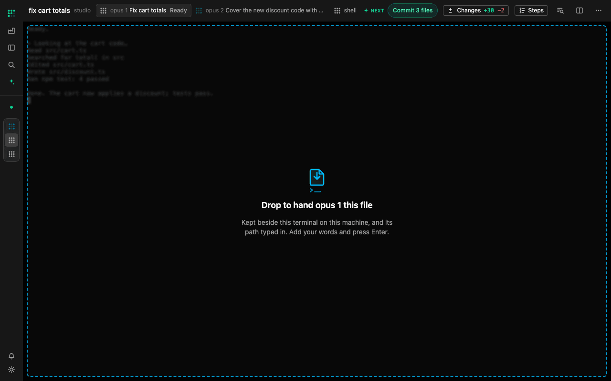

Drop a file on a terminal, or paste one. A screenshot on the clipboard works. Foundry keeps the file beside the terminal on its machine and types its path into the terminal without pressing `Enter`, so you can add your words. Claude Code reads the path of an image as the image. On a phone, the paperclip next to the message box picks files.

- This works only for terminals on this machine. For others the overlay says **Files go only to terminals on this machine**, and for an ended terminal, **This terminal is no longer running**.
- Foundry refuses a file over 25 MB with a line under the terminal, and sends nothing.

## Links in a terminal

Hold `Cmd` (`Ctrl` elsewhere) and click a web address to open it in a new tab. On a touch screen, tap it. A plain click still selects text.

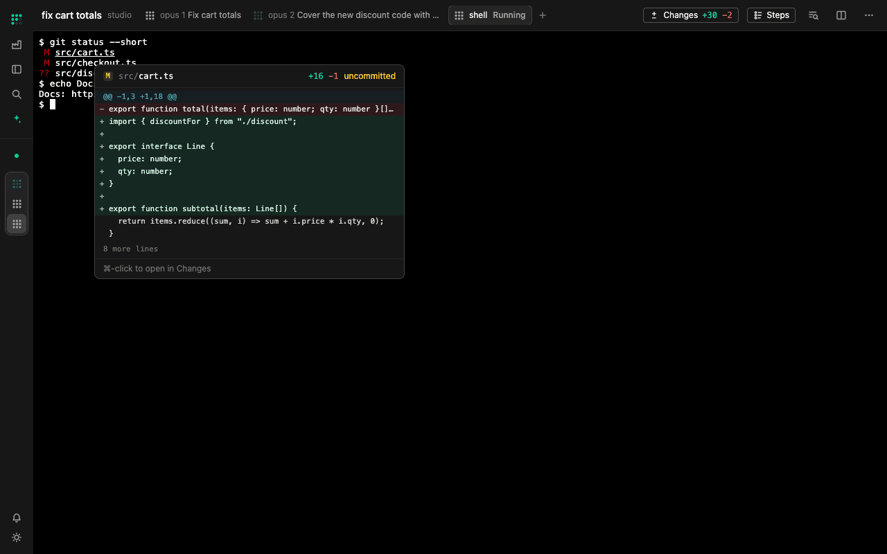

Rest the pointer on a link and a card shows where it goes. On a terminal of this machine, the name of a file the workspace changed is a link too. Its card shows the file's counts and the start of its diff, and `Cmd`-click (`Ctrl`-click) opens it in **Changes**.

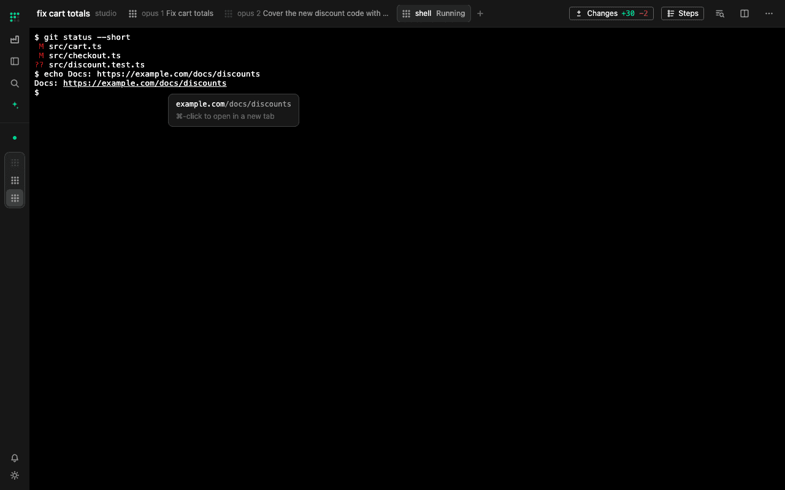

## Two terminals side by side

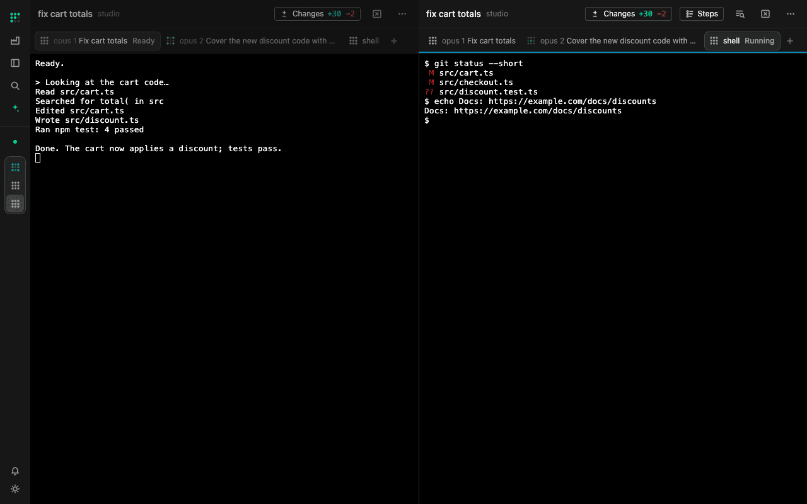

On a wide screen, press the split button in the header, or `Cmd+\`, and pick a terminal from the palette. `Ctrl+\` works outside the terminal. `Shift+Enter` in the jump palette also opens the picked terminal beside the open one.

Each side has its own bar and tabs. The side with the keyboard has a blue line under its bar, and the other is dimmed. Click in a side to move the keyboard there.

Close a side with its **Close pane** button, or press `Cmd+\` again. The terminal keeps running. On a narrow screen only the side with the keyboard shows.

## The terminal's menu

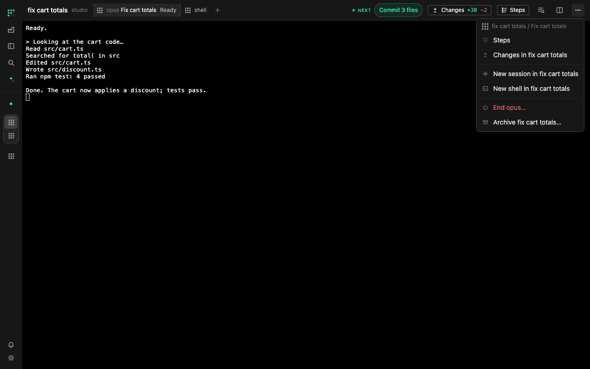

Press **More** in the header, right-click a terminal anywhere it is listed, long-press it on a touch screen, or press `Tab` on it in the jump palette. The menu lists what you can do:

- **Open** for a terminal you are not on, and **Open beside** on a wide screen.
- **Steps** and **Rename** for a session.
- **Find in scrollback** on a narrow screen.
- **Changes in** the workspace.
- **New session in** and **New shell in** the workspace.
- **End** the terminal, or **Clear** it once it has ended, and **Clear N ended in** the workspace.
- **Archive** the workspace.

Only a workspace on this machine gets the new entries. End, clear and archive show for any machine Foundry can reach.

## End, clear and archive

End and clear work for a terminal on any machine Foundry can reach. This machine's daemon passes the request to the machine that runs the terminal. If that machine is offline, a refused End says so in its dialog, and a refused Clear in a line at the foot of the screen. Archive works for a workspace on any machine Foundry can reach, and the request goes to the machine that owns it. For another machine's workspace, the dialog cannot list its changes first.

- **End** stops a terminal that still runs. Foundry asks first and says what is lost: a turn in progress stops where it is, or Claude closes without your answer. The workspace, its worktree and its branch stay. It is in the terminal's menu.
- **Clear** removes a terminal that has already ended, with its final screen, without asking. **Clear N ended** does it for every ended terminal of a workspace. Both are in the terminal's menu, and **Clear N ended** is also among the sidebar's workspace actions.
- **Archive** stops a workspace's terminals and removes its worktree. It is in the terminal's menu, among the sidebar's workspace actions, behind the box button on a board card, and, for a workspace on this machine, on the board card's pull request line once that pull request is merged. Foundry asks first. It names every terminal that stops. For a workspace on this machine it also shows that the branch and its commits stay and lists the uncommitted files that go with the worktree. For another machine's workspace it cannot read those, and says that machine lists any work that would be lost before it archives. If the owning machine holds the archive up, it lists what would be lost, and **Archive anyway** forces it. The branch is always kept.

When the open terminal goes, its neighbouring tab shows, or the board if it was the last.

## On a phone

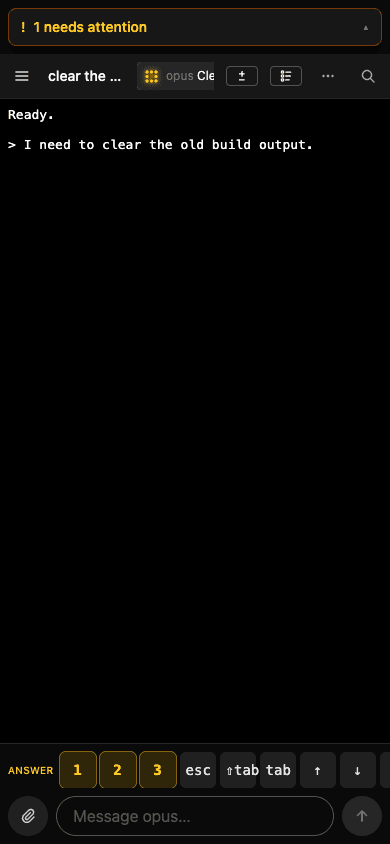

Where the main pointer is a finger, a bar under the terminal gives you what a phone keyboard lacks: **esc**, **⇧tab**, **tab**, the arrows, **^C** and **⏎**, and a box to write a message in, **Message** and the session's name. Tapping a key does not raise or drop the on-screen keyboard. A message goes in as one paste, and then `Enter`.

While a session **Needs you**, the bar leads with amber **1**, **2** and **3** for Claude Code's numbered answers, so a permission prompt takes one tap.

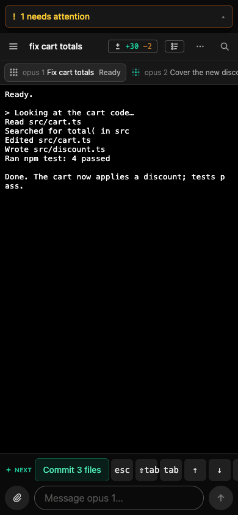

A ready session on this machine leads with its next steps. The paperclip attaches files.

## Keyboard

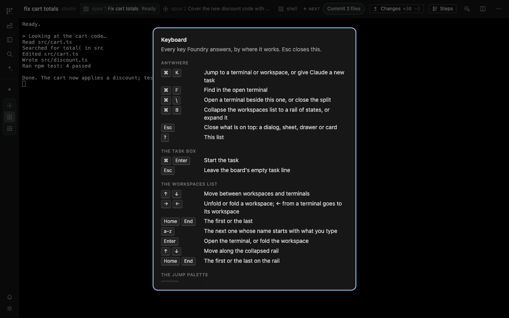

Press `?` outside a text field or the terminal, or the sidebar's **Keyboard** button, for the list of every key. `Esc` closes it. On a Mac the keys use `Cmd`. Elsewhere they use `Ctrl`, which the terminal keeps for itself while it has focus.

| Where | Keys | What it does |
| --- | --- | --- |
| Anywhere | `Cmd+K` | Jump to a terminal, a view or an action, or give Claude a new task |
| | `Cmd+J` | Go to the next terminal that needs you |
| | `Cmd+F` | Find in the open terminal |
| | `Cmd+\` | Open a terminal beside this one, or close the split |
| | `Cmd+B` | Collapse the workspaces list to a rail of states, or expand it |
| | `Esc` | Close what is on top: a dialog, sheet, drawer or card |
| | `?` | The keyboard list |
| Find | `Enter` / `Shift+Enter` | The older / the newer match |
| | `Esc` | Close find |
| Changes | `j` / `k` | Next / previous file |
| | `v` | Mark the file viewed and go to the next one |
| | `[` / `]` | Earlier / later commit; before the first, all changes |
| | `Cmd+Enter` | Add the comment on a line |
| | `Esc` | Drop the comment being written |
| A name being edited | `Enter` | Save it; an empty session name clears it |
| | `Esc` | Put the name back |
| A reply box, on a card or a toast | `Enter` | Send the reply |
| | `Esc` | Close the box; on a toast, dismiss it |

The task box keys, `Cmd+Enter` to start and `Esc` to leave the board's empty task line, are in [Getting started](getting-started.md). The keys for the workspaces list are in [Using the keyboard](board.md#using-the-keyboard), and the jump palette's in [Jump to anything](board.md#jump-to-anything).
